# 在线商城系统设计与开发-代码

> 🎓 **计算机毕业设计 · 在线商城系统设计与开发-代码**
>
> 本仓库只放**项目介绍 + 运行截图**（截图是站点带水印的原图，存在仓库 `images/` 里）。
>
> 👉 **完整可运行源码 / 数据库脚本 / 部署文档：[点我获取](https://geekcode.top/archives/%E5%9C%A8%E7%BA%BF%E5%95%86%E5%9F%8E%E7%B3%BB%E7%BB%9F%E8%AE%BE%E8%AE%A1%E4%B8%8E%E5%BC%80%E5%8F%91-%E4%BB%A3%E7%A0%81?utm_source=github)**
>
> 💬 咨询微信：**ir9372**　|　🌐 更多项目：[极客代码 geekcode.top](https://geekcode.top/?utm_source=github)
>
> 📌 项目详情页：<https://geekcode.top/archives/%E5%9C%A8%E7%BA%BF%E5%95%86%E5%9F%8E%E7%B3%BB%E7%BB%9F%E8%AE%BE%E8%AE%A1%E4%B8%8E%E5%BC%80%E5%8F%91-%E4%BB%A3%E7%A0%81?utm_source=github>

<table><td width="230" align="center"> <b>扫码加微信 ir9372</b></td><td valign="middle">📦 源码 = 项目介绍 + 全部运行截图 + 数据库 + 部署文档 👉 点上方任意截图，直接跳到 <b>极客代码 geekcode.top</b> 详情页</td></table>

---

<h1>在线商城系统设计与开发-代码</h1>
<h2>项目概述</h2>

本项目名为“在线商城系统设计与开发”，旨在构建一个基于 Web 的综合性电子商务平台，实现商品展示、交易管理及用户交互的全流程数字化。系统采用前后端分离架构，前台面向普通消费者，提供商品信息浏览、资讯阅读、购物车管理、订单处理及个人中心服务；后台面向管理员，涵盖商品全生命周期管理、订单审核、用户维护及内容配置等功能。核心业务逻辑包括商品分类检索、多维度评价反馈、即时客服沟通以及收藏与地址管理。适用人群为中小型电商运营者及追求便捷购物体验的用户群体。技术架构上，后端依托 Spring Boot 框架结合 MyBatis-Plus 进行高效数据持久化，利用 Shiro 实现安全权限控制，前端集成 Vue 生态，确保系统的稳定性、扩展性及良好的用户体验。

<h2>技术架构</h2>
<h3>总体架构设计</h3>

本系统采用经典的前后端分离架构模式。后端作为独立的服务层，负责业务逻辑处理、数据访问及安全认证；前端作为表现层，通过 HTTP/HTTPS 协议调用后端 API 接口获取数据并渲染页面。这种架构降低了模块间的耦合度，提升了开发与部署效率。

<h3>后端技术选型</h3>
<ol>
<li><strong>Spring Boot</strong>：作为核心框架，利用其自动配置和起步依赖特性，快速搭建 RESTful API 服务，简化了传统 Java EE 开发的繁琐配置。</li>
<li><strong>MyBatis-Plus</strong>：在 MyBatis 基础上增强，提供了通用的 CRUD 操作封装及条件构造器，显著减少了样板代码，提高了数据库操作的开发效率与维护性。</li>
<li><strong>Apache Shiro</strong>：用于身份验证（Authentication）、授权（Authorization）及会话管理。通过拦截器机制保护敏感接口，确保只有具备相应权限的用户才能访问特定资源。</li>
<li><strong>MySQL</strong>：作为关系型数据库管理系统，存储用户信息、商品数据、订单记录及评论日志等核心业务数据。</li>
<li><strong>其他组件</strong>：引入 <code>commons-lang3</code> 处理字符串工具类，<code>validation-api</code> 进行参数校验，<code>protobuf-java</code> 可能用于高性能数据传输或序列化场景。</li>
</ol>
<h3>前端技术栈</h3>

根据项目类型 <code>vue-integrated</code> 推断，前端基于 Vue.js 框架构建，配合路由管理器实现单页应用（SPA）体验，确保页面切换流畅且无需频繁刷新服务器请求。

<h3>数据库设计要点</h3>

数据库设计遵循第三范式，主要实体包括：

<ul>
<li><strong>用户域</strong>：<code>yonghu</code>（用户表），存储账号、密码、基本信息。</li>
<li><strong>商品域</strong>：<code>shangpinxinxi</code>（商品信息表）、<code>shangpinfenlei</code>（商品分类表），关联商品属性与类别。</li>
<li><strong>交易域</strong>：<code>orders</code>（订单表）、<code>address</code>（地址表）、<code>cart</code>（购物车表），记录购买行为与物流信息。</li>
<li><strong>互动域</strong>：<code>discussshangpinxinxi</code>（商品评论）、<code>shangpinpingjia</code>（商品评价）、<code>news</code>（资讯）、<code>chat</code>（聊天记录）。</li>
<li><strong>配置域</strong>：<code>config</code>（系统配置）、<code>storeup</code>（收藏记录）。</li>
</ul>

各表之间通过外键或逻辑关联建立联系，例如订单表关联用户ID和商品ID，评论表关联用户ID和商品ID，确保数据完整性。

<h2>功能模块</h2>
<h3>前台用户端功能</h3>

前台界面简洁直观，聚焦于购物流程与信息获取，具体模块如下：

<ol>
<li><strong>首页与导航</strong></li>
</ol>
<ul>
<li>展示系统概览，提供“商品信息”和“商品资讯”两个主要导航入口。</li>
<li>支持用户注册与登录，进入个性化服务空间。</li>
</ul>
<ol start="2">
<li><strong>商品浏览与搜索</strong></li>
</ol>
<ul>
<li><strong>商品信息列表</strong>：以网格或列表形式展示所有上架商品，支持按分类筛选。</li>
<li><strong>商品分类详情</strong>：点击分类可查看该类别下的具体商品集合。</li>
<li><strong>商品信息详情</strong>：展示单个商品的详细图片、描述、价格及库存状态。</li>
</ul>
<ol start="3">
<li><strong>资讯中心</strong></li>
</ol>
<ul>
<li><strong>商品资讯列表</strong>：展示平台发布的新闻、活动公告或导购文章。</li>
<li><strong>商品资讯详情</strong>：查看资讯全文内容。</li>
</ul>
<ol start="4">
<li><strong>互动与反馈</strong></li>
</ol>
<ul>
<li><strong>商品评价列表/详情</strong>：查看其他用户对商品的评分与文字评价。</li>
<li><strong>商品信息评论列表/详情</strong>：针对商品发布新的评论或回复已有评论，形成社区讨论氛围。</li>
<li><strong>客服聊天</strong>：内置即时通讯模块，用户可与商家或客服进行实时沟通，解决售前售后问题。</li>
</ul>
<ol start="5">
<li><strong>交易管理</strong></li>
</ol>
<ul>
<li><strong>购物车</strong>：将感兴趣的商品加入购物车，支持数量修改与结算预览。</li>
<li><strong>我的订单</strong>：查看所有历史订单及当前状态（如待支付、已发货等），支持订单追踪。</li>
</ul>
<ol start="6">
<li><strong>个人中心</strong></li>
</ol>
<ul>
<li><strong>个人信息维护</strong>：修改基本资料。</li>
<li><strong>我的地址</strong>：新增、编辑或删除收货地址，方便下单时快速选择。</li>
<li><strong>我的收藏</strong>：查看已收藏的商品列表，便于后续回访购买。</li>
</ul>
<h3>后台管理端功能</h3>

后台提供全面的数据管理与系统配置能力，主要模块如下：

<ol>
<li><strong>基础数据管理</strong></li>
</ol>
<ul>
<li><strong>用户管理 (<code>/yonghu</code>)</strong>：查看注册用户列表，重置密码，禁用违规账号。</li>
<li><strong>商品分类管理 (<code>/shangpinfenlei</code>)</strong>：创建、修改、删除商品类别，构建分类树结构。</li>
<li><strong>商品信息管理 (<code>/shangpinxinxi</code>)</strong>：上架新商品，编辑现有商品详情，调整库存与价格，下架过期商品。</li>
</ul>
<ol start="2">
<li><strong>内容与互动管理</strong></li>
</ol>
<ul>
<li><strong>商品资讯管理 (<code>/news</code>)</strong>：发布和管理平台新闻、促销活动文案。</li>
<li><strong>商品评价管理 (<code>/shangpinpingjia</code>)</strong>：审核用户提交的商品评分，处理恶意差评或虚假评价。</li>
<li><strong>商品评论管理 (<code>/discussshangpinxinxi</code>)</strong>：监控评论区动态，删除不当言论，维护社区秩序。</li>
<li><strong>客服管理 (<code>/chat</code>)</strong>：查看客服聊天记录，监控服务质量，必要时介入对话。</li>
</ul>
<ol start="3">
<li><strong>交易与用户资产</strong></li>
</ol>
<ul>
<li><strong>订单管理 (<code>/orders/:status</code>)</strong>：根据不同状态（全部、待付款、已完成等）筛选订单，执行发货、退款等操作。</li>
<li><strong>收藏管理 (<code>/storeup</code>)</strong>：查看用户的收藏数据，分析热门商品趋势。</li>
</ul>
<ol start="4">
<li><strong>系统配置</strong></li>
</ol>
<ul>
<li><strong>配置文件 (<code>/config</code>)</strong>：设置轮播图、网站名称、联系方式等全局参数，无需修改代码即可更新前台显示内容。</li>
</ul>
<h2>用户角色与权限</h2>

本系统基于 Apache Shiro 框架实现严格的角色权限控制，主要划分为两类角色：

<h3>1. 普通用户 (Customer)</h3>
<ul>
<li><strong>权限范围</strong>：仅限访问前台功能。</li>
<li><strong>具体权限</strong>：</li>
<li><strong>公开访问</strong>：浏览首页、商品列表、商品详情、资讯列表及详情、商品评价与评论列表。</li>
<li><strong>需登录访问</strong>：注册后登录，方可使用购物车添加商品、提交订单、管理收货地址、查看个人订单状态、收藏商品、发布评论/评价、使用客服聊天功能。</li>
<li><strong>限制</strong>：无法访问任何后台管理接口，无权修改他人数据或系统配置。</li>
</ul>
<h3>2. 管理员 (Administrator)</h3>
<ul>
<li><strong>权限范围</strong>：拥有后台所有功能的完全控制权。</li>
<li><strong>具体权限</strong>：</li>
<li><strong>CRUD 操作</strong>：对商品、分类、资讯、用户信息进行增删改查。</li>
<li><strong>业务审批</strong>：处理订单状态流转，审核评论与评价内容。</li>
<li><strong>系统维护</strong>：配置系统参数，监控客服聊天日志，管理用户账号状态。</li>
<li><strong>数据查看</strong>：可查看所有用户的收藏记录、订单详情及个人资料。</li>
<li><strong>限制</strong>：通常不直接参与前台购物流程（虽技术上可行，但业务逻辑上应隔离），主要职责为运营与维护。</li>
</ul>
<h2>项目特色与创新点</h2>
<ol>
<li>
<strong>一体化社交电商体验</strong>
   系统不仅包含传统的商品买卖流程，还深度整合了“商品资讯”、“用户评论”、“商品评价”及“即时客服聊天”模块。这种设计打破了纯交易平台的冰冷感，通过内容营销（资讯）和社区互动（评论/评价）增强用户粘性，同时通过在线客服缩短决策路径，体现了现代电商“内容+社交+交易”融合的趋势。

</li>
<li>
<strong>精细化权限与安全体系</strong>
   引入 Apache Shiro 而非简单的 Session 过滤，实现了更细粒度的权限控制。结合 MyBatis-Plus 的安全查询机制，有效防止 SQL 注入等常见攻击，保障了用户隐私数据（如地址、订单）的安全性。

</li>
<li>
<strong>高效的数据交互与开发模式</strong>
   后端采用 Spring Boot + MyBatis-Plus 组合，极大提升了 CRUD 开发效率。MyBatis-Plus 提供的分页插件和条件构造器使得复杂查询（如多条件筛选商品、统计订单状态）变得简洁明了。前端 Vue 集成方案保证了页面的响应速度和用户体验的流畅性。

</li>
<li>
<strong>灵活的配置驱动</strong>
   通过后台 <code>/config</code> 模块，管理员可以动态调整前台展示的关键元素（如轮播图、公告栏），无需重新部署代码即可适应节日促销或紧急通知的需求，增强了系统的运营灵活性。

</li>
</ol>
<h2>部署环境</h2>

为确保系统正常运行，建议部署以下软件环境：

<ol>
<li><strong>操作系统</strong></li>
</ol>
<ul>
<li>Windows Server / Linux (CentOS, Ubuntu) / macOS</li>
</ul>
<ol start="2">
<li><strong>Java 运行环境</strong></li>
</ol>
<ul>
<li>JDK 1.8 或更高版本（推荐 JDK 8 或 JDK 11，以确保与 Spring Boot 版本的兼容性）。</li>
</ul>
<ol start="3">
<li><strong>数据库系统</strong></li>
</ol>
<ul>
<li>MySQL 5.7 或 MySQL 8.0。需提前创建数据库并导入初始化 SQL 脚本。</li>
</ul>
<ol start="4">
<li><strong>Web 服务器</strong></li>
</ol>
<ul>
<li>内置 Tomcat（由 Spring Boot 自动启动，生产环境建议使用 Nginx 作为反向代理服务器，以优化静态资源加载和负载均衡）。</li>
</ul>
<ol start="5">
<li><strong>前端运行环境</strong></li>
</ol>
<ul>
<li>Node.js (建议 v14.x 或 v16.x LTS 版本)，用于构建 Vue 前端项目。</li>
<li>npm 或 yarn 包管理器。</li>
</ul>
<ol start="6">
<li><strong>浏览器兼容性</strong></li>
</ol>
<ul>
<li>支持主流现代浏览器：Chrome (最新版), Firefox, Edge, Safari。</li>
</ul>
<ol start="7">
<li><strong>其他依赖</strong></li>
</ol>
<ul>
<li>Maven 3.6+：用于后端项目的依赖管理和打包构建。</li>
</ul>
<h2>五、技术特性</h2>
<ul>
<li>前后端集成部署，前端资源打包至后端 static 目录</li>
<li>使用 MyBatis-Plus 简化数据访问层开发</li>
<li>集成 Shiro 权限框架实现角色权限控制</li>
</ul>
<h2>六、功能模块截图</h2>
<h3>前台用户端</h3>
<h4>前台首页</h4>

<h4>前台登录页</h4>

<h4>前台注册页</h4>

<a href="https://geekcode.top/archives/%E5%9C%A8%E7%BA%BF%E5%95%86%E5%9F%8E%E7%B3%BB%E7%BB%9F%E8%AE%BE%E8%AE%A1%E4%B8%8E%E5%BC%80%E5%8F%91-%E4%BB%A3%E7%A0%81?utm_source=github" title="查看完整源码">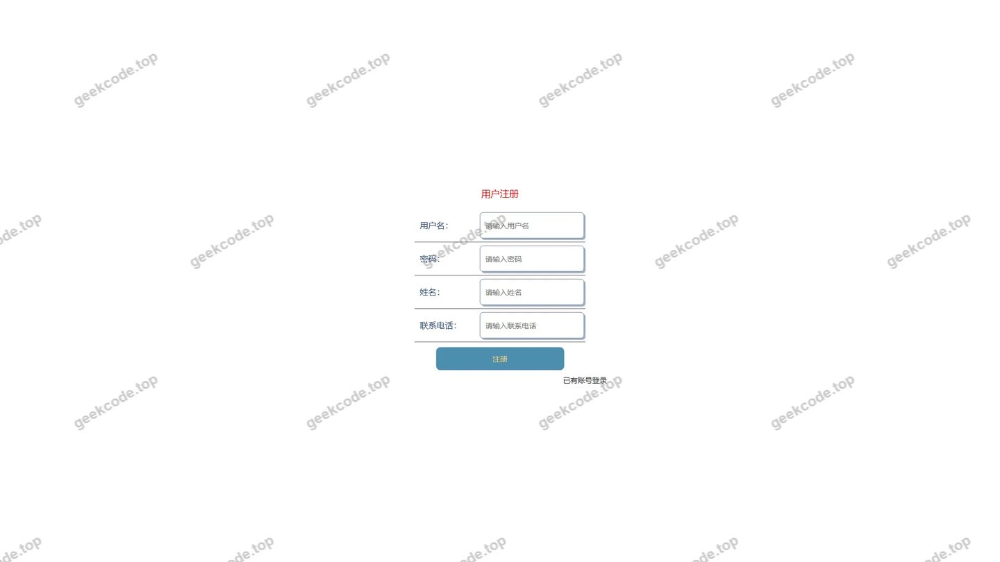</a>

<h4>前台-商品资讯列表</h4>

<h4>前台-商品信息列表</h4>

<h4>前台-商品信息评论列表</h4>

<h4>前台-商品评价列表</h4>

<h4>前台个人中心</h4>

<a href="https://geekcode.top/archives/%E5%9C%A8%E7%BA%BF%E5%95%86%E5%9F%8E%E7%B3%BB%E7%BB%9F%E8%AE%BE%E8%AE%A1%E4%B8%8E%E5%BC%80%E5%8F%91-%E4%BB%A3%E7%A0%81?utm_source=github" title="查看完整源码">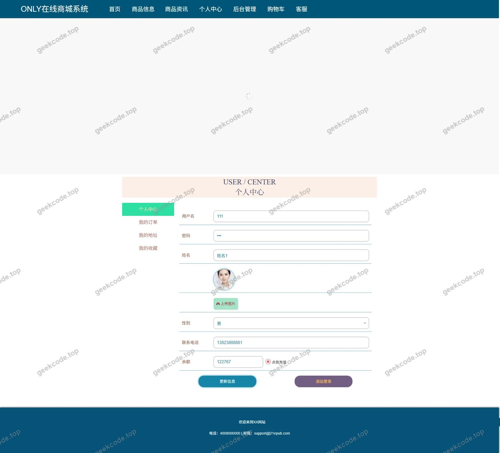</a>

<h4>前台-我的地址列表</h4>

<h4>前台-我的订单列表</h4>

<h4>前台-我的收藏列表</h4>

<h4>前台-商品资讯-详情</h4>

<h4>前台-商品信息-详情</h4>

<a href="https://geekcode.top/archives/%E5%9C%A8%E7%BA%BF%E5%95%86%E5%9F%8E%E7%B3%BB%E7%BB%9F%E8%AE%BE%E8%AE%A1%E4%B8%8E%E5%BC%80%E5%8F%91-%E4%BB%A3%E7%A0%81?utm_source=github" title="查看完整源码">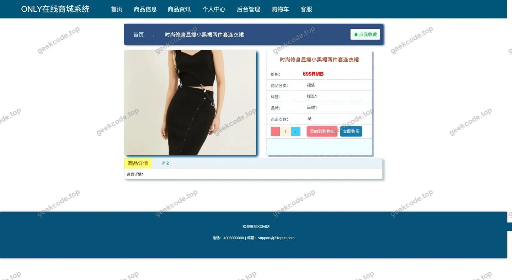</a>

<h4>前台-商品分类列表</h4>

<h4>前台-购物车列表</h4>

<h4>前台-商品信息评论-详情</h4>

<a href="https://geekcode.top/archives/%E5%9C%A8%E7%BA%BF%E5%95%86%E5%9F%8E%E7%B3%BB%E7%BB%9F%E8%AE%BE%E8%AE%A1%E4%B8%8E%E5%BC%80%E5%8F%91-%E4%BB%A3%E7%A0%81?utm_source=github" title="查看完整源码">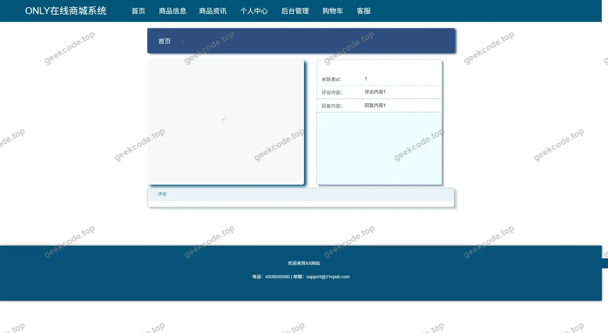</a>

<h4>前台-商品分类-详情</h4>

<a href="https://geekcode.top/archives/%E5%9C%A8%E7%BA%BF%E5%95%86%E5%9F%8E%E7%B3%BB%E7%BB%9F%E8%AE%BE%E8%AE%A1%E4%B8%8E%E5%BC%80%E5%8F%91-%E4%BB%A3%E7%A0%81?utm_source=github" title="查看完整源码">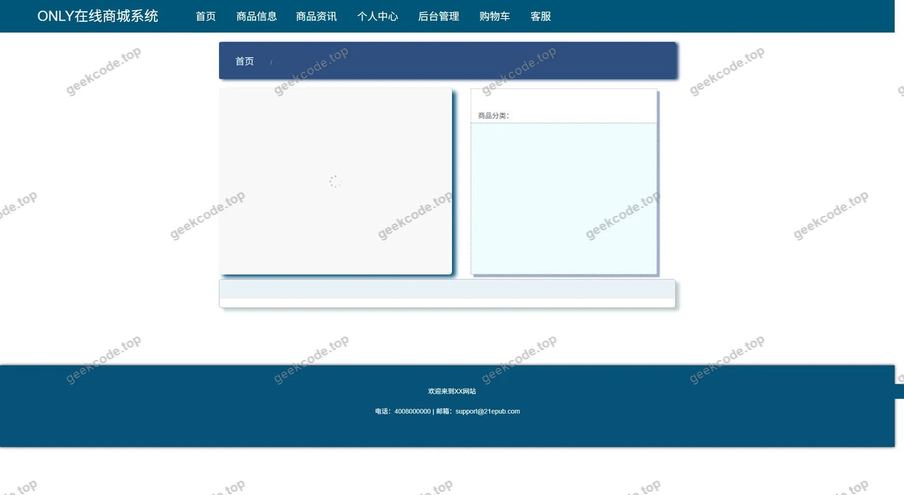</a>

<h4>前台-商品评价-详情</h4>

<a href="https://geekcode.top/archives/%E5%9C%A8%E7%BA%BF%E5%95%86%E5%9F%8E%E7%B3%BB%E7%BB%9F%E8%AE%BE%E8%AE%A1%E4%B8%8E%E5%BC%80%E5%8F%91-%E4%BB%A3%E7%A0%81?utm_source=github" title="查看完整源码">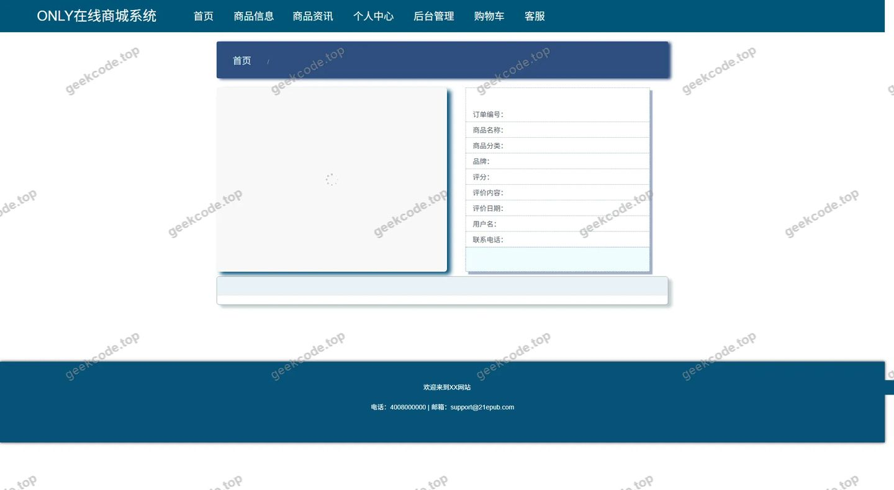</a>

<h4>前台-客服聊天</h4>

<a href="https://geekcode.top/archives/%E5%9C%A8%E7%BA%BF%E5%95%86%E5%9F%8E%E7%B3%BB%E7%BB%9F%E8%AE%BE%E8%AE%A1%E4%B8%8E%E5%BC%80%E5%8F%91-%E4%BB%A3%E7%A0%81?utm_source=github" title="查看完整源码">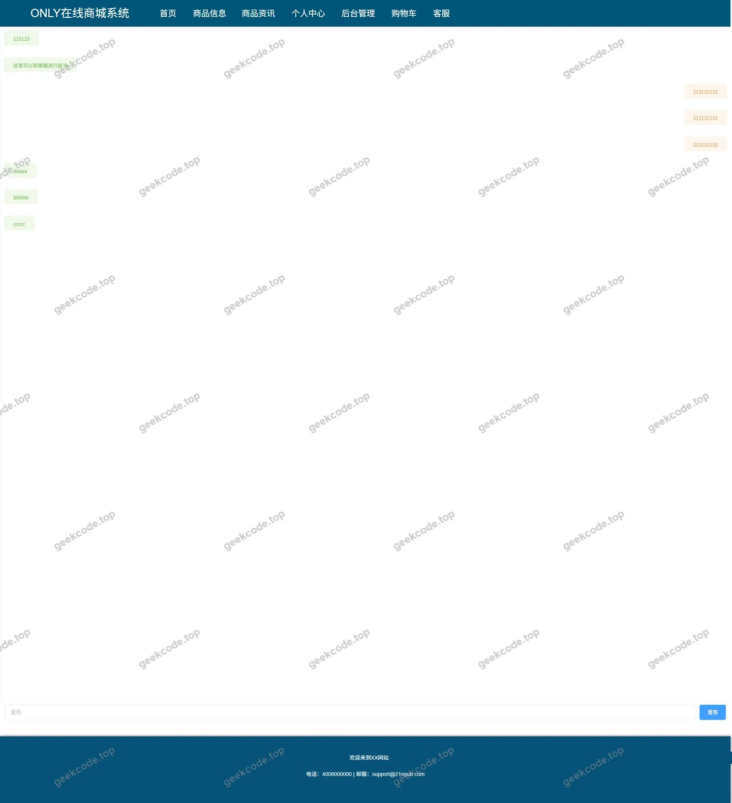</a>

<h3>后台管理端</h3>
<h4>后台-在线客服</h4>

<a href="https://geekcode.top/archives/%E5%9C%A8%E7%BA%BF%E5%95%86%E5%9F%8E%E7%B3%BB%E7%BB%9F%E8%AE%BE%E8%AE%A1%E4%B8%8E%E5%BC%80%E5%8F%91-%E4%BB%A3%E7%A0%81?utm_source=github" title="查看完整源码">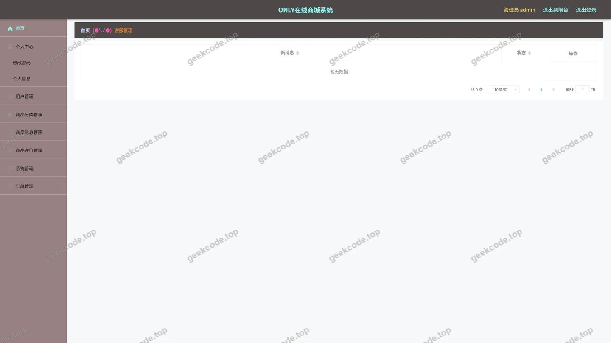</a>

<h4>后台-系统配置</h4>

<a href="https://geekcode.top/archives/%E5%9C%A8%E7%BA%BF%E5%95%86%E5%9F%8E%E7%B3%BB%E7%BB%9F%E8%AE%BE%E8%AE%A1%E4%B8%8E%E5%BC%80%E5%8F%91-%E4%BB%A3%E7%A0%81?utm_source=github" title="查看完整源码">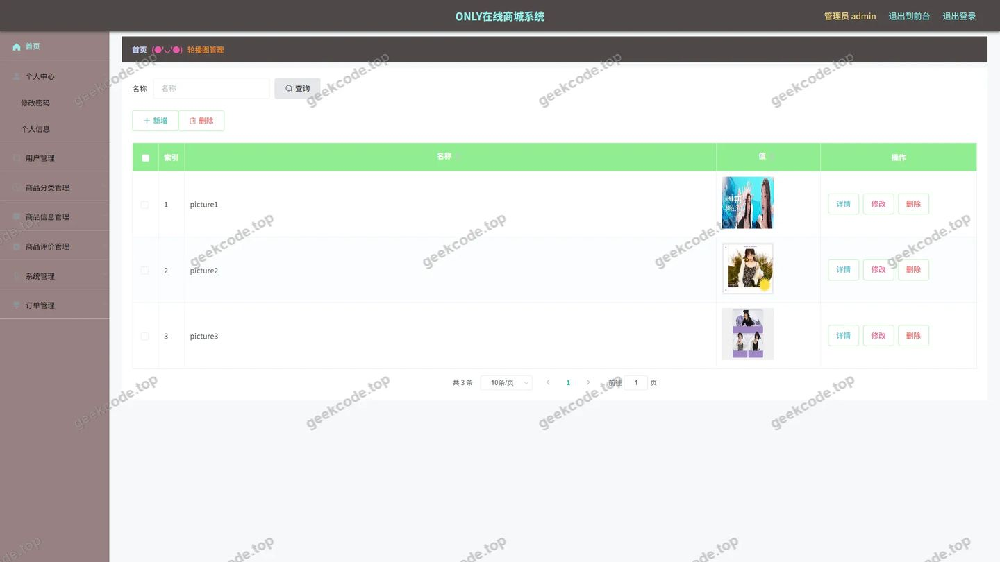</a>

<h4>后台-商品信息评论</h4>

<a href="https://geekcode.top/archives/%E5%9C%A8%E7%BA%BF%E5%95%86%E5%9F%8E%E7%B3%BB%E7%BB%9F%E8%AE%BE%E8%AE%A1%E4%B8%8E%E5%BC%80%E5%8F%91-%E4%BB%A3%E7%A0%81?utm_source=github" title="查看完整源码">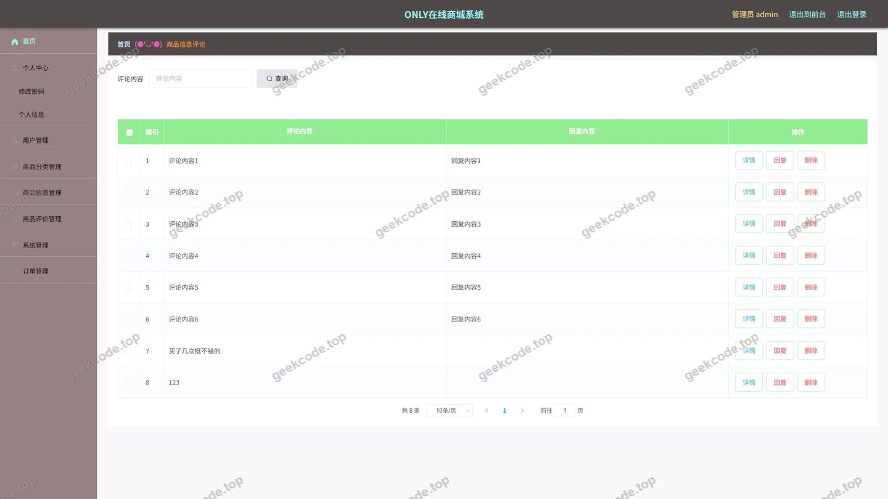</a>

<h4>后台首页</h4>

<a href="https://geekcode.top/archives/%E5%9C%A8%E7%BA%BF%E5%95%86%E5%9F%8E%E7%B3%BB%E7%BB%9F%E8%AE%BE%E8%AE%A1%E4%B8%8E%E5%BC%80%E5%8F%91-%E4%BB%A3%E7%A0%81?utm_source=github" title="查看完整源码">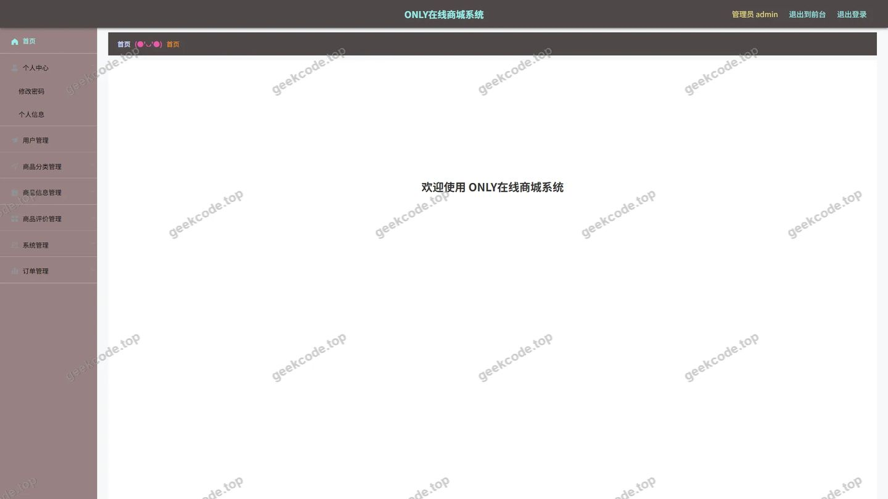</a>

<h4>后台-登录</h4>

<a href="https://geekcode.top/archives/%E5%9C%A8%E7%BA%BF%E5%95%86%E5%9F%8E%E7%B3%BB%E7%BB%9F%E8%AE%BE%E8%AE%A1%E4%B8%8E%E5%BC%80%E5%8F%91-%E4%BB%A3%E7%A0%81?utm_source=github" title="查看完整源码">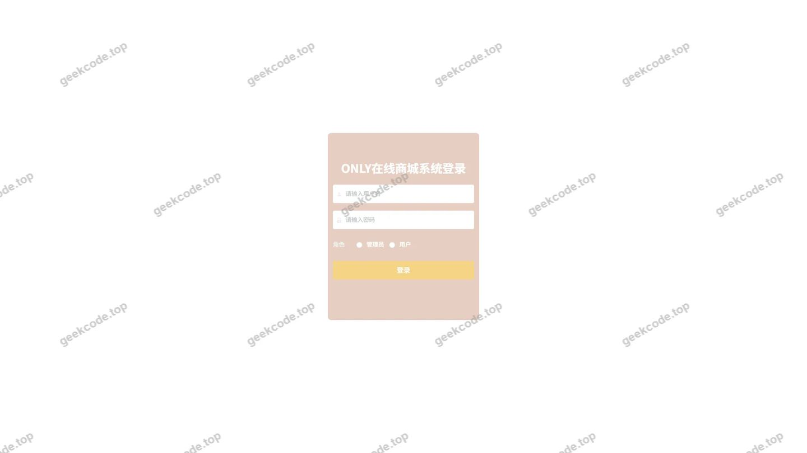</a>

<h4>后台-公告信息</h4>

<a href="https://geekcode.top/archives/%E5%9C%A8%E7%BA%BF%E5%95%86%E5%9F%8E%E7%B3%BB%E7%BB%9F%E8%AE%BE%E8%AE%A1%E4%B8%8E%E5%BC%80%E5%8F%91-%E4%BB%A3%E7%A0%81?utm_source=github" title="查看完整源码">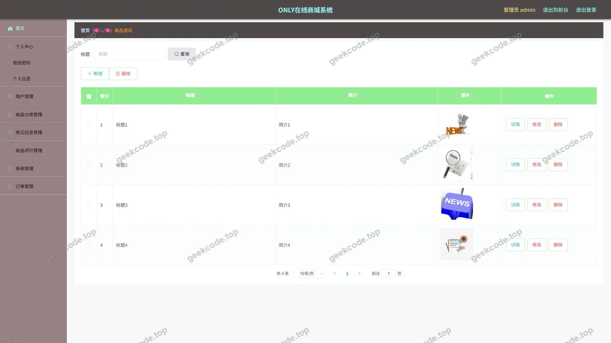</a>

<h4>后台-订单-状态</h4>

<a href="https://geekcode.top/archives/%E5%9C%A8%E7%BA%BF%E5%95%86%E5%9F%8E%E7%B3%BB%E7%BB%9F%E8%AE%BE%E8%AE%A1%E4%B8%8E%E5%BC%80%E5%8F%91-%E4%BB%A3%E7%A0%81?utm_source=github" title="查看完整源码">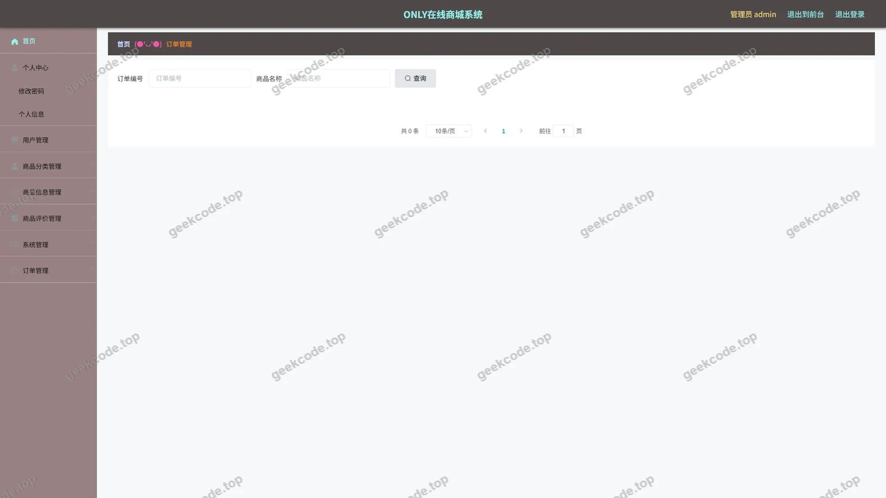</a>

<h4>后台-商品分类</h4>

<a href="https://geekcode.top/archives/%E5%9C%A8%E7%BA%BF%E5%95%86%E5%9F%8E%E7%B3%BB%E7%BB%9F%E8%AE%BE%E8%AE%A1%E4%B8%8E%E5%BC%80%E5%8F%91-%E4%BB%A3%E7%A0%81?utm_source=github" title="查看完整源码">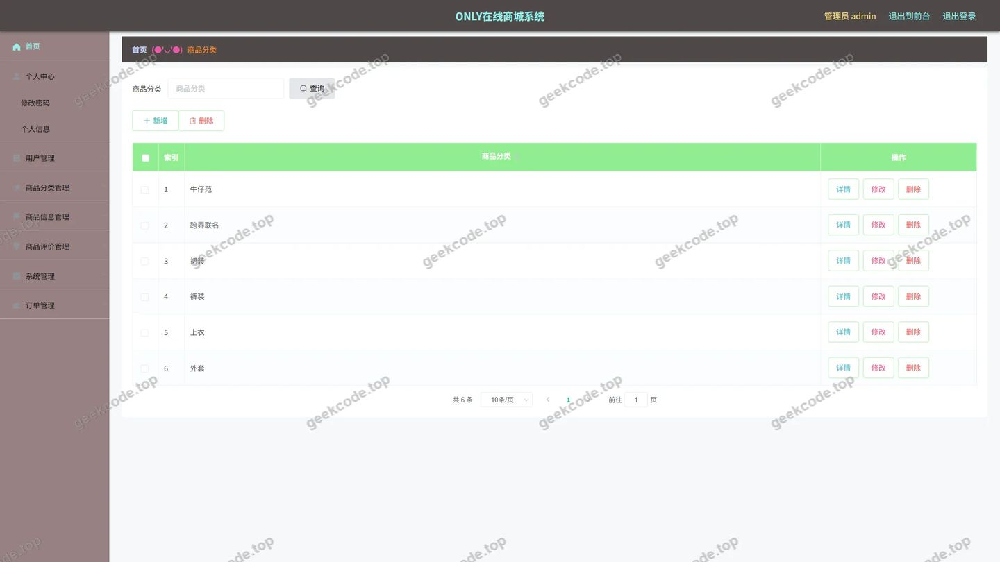</a>

<h4>后台-商品评价</h4>

<a href="https://geekcode.top/archives/%E5%9C%A8%E7%BA%BF%E5%95%86%E5%9F%8E%E7%B3%BB%E7%BB%9F%E8%AE%BE%E8%AE%A1%E4%B8%8E%E5%BC%80%E5%8F%91-%E4%BB%A3%E7%A0%81?utm_source=github" title="查看完整源码">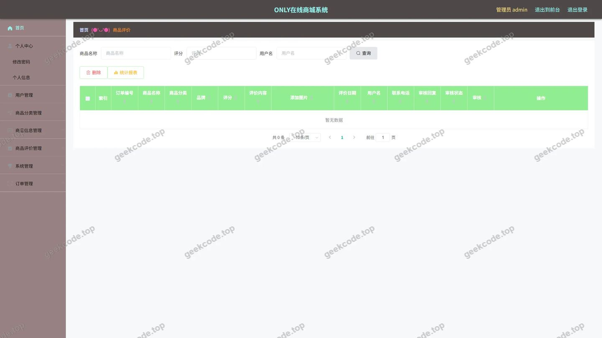</a>

<h4>后台-商品信息</h4>

<a href="https://geekcode.top/archives/%E5%9C%A8%E7%BA%BF%E5%95%86%E5%9F%8E%E7%B3%BB%E7%BB%9F%E8%AE%BE%E8%AE%A1%E4%B8%8E%E5%BC%80%E5%8F%91-%E4%BB%A3%E7%A0%81?utm_source=github" title="查看完整源码">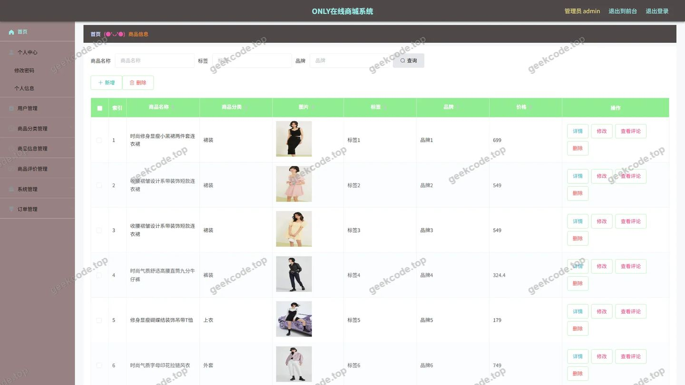</a>

<h4>后台-收藏</h4>

---

## 获取完整源码

| 项目 | 说明 |
| --- | --- |
| 项目名 | 在线商城系统设计与开发-代码 |
| 运行截图 | 本文 30 张（站点带水印原图，仓库 `images/` 目录） |
| 完整源码 | [https://geekcode.top/archives/%E5%9C%A8%E7%BA%BF%E5%95%86%E5%9F%8E%E7%B3%BB%E7%BB%9F%E8%AE%BE%E8%AE%A1%E4%B8%8E%E5%BC%80%E5%8F%91-%E4%BB%A3%E7%A0%81?utm_source=github](https://geekcode.top/archives/%E5%9C%A8%E7%BA%BF%E5%95%86%E5%9F%8E%E7%B3%BB%E7%BB%9F%E8%AE%BE%E8%AE%A1%E4%B8%8E%E5%BC%80%E5%8F%91-%E4%BB%A3%E7%A0%81?utm_source=github) |
| 咨询微信 | **ir9372**（备注：jingpin-yuanma） |
| 更多项目 | [极客代码 geekcode.top](https://geekcode.top/?utm_source=github) |

> 需要源码、部署、改配置、跑不起来等问题，加微信 ir9372 沟通，说明项目名即可。
